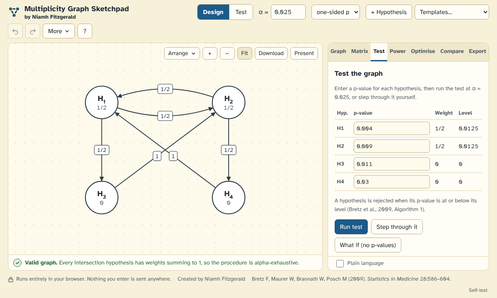
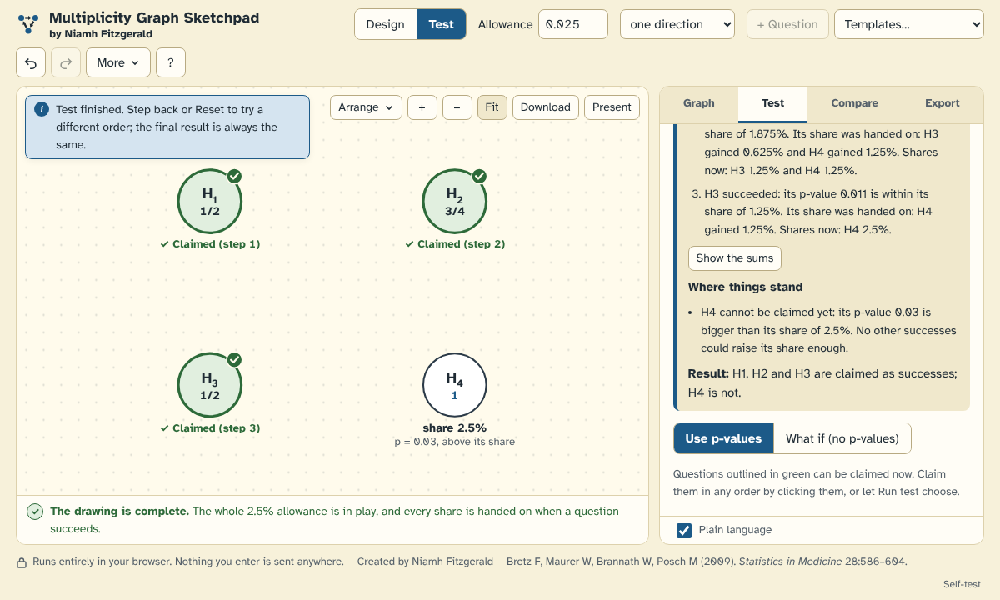

# Multiplicity Graph Sketchpad: Quick Start

Niamh Fitzgerald · version 1.4.24

Six steps from opening the page to a tested graph. The [user guide](user-guide.md) has the details.

Open the Sketchpad: <https://niamhfitzgerald.github.io/multiplicity-graph-sketchpad/>

## 1. Start a graph

The page opens with an example graph of four hypotheses. To start your own, pick a graph from **Templates…** at the top of the page. Or press **More**, then **Clear graph…**, confirm, and double-click empty space to add each hypothesis.

## 2. Set the weights and the arrows

Double-click a hypothesis: the top half renames it, and the bottom half changes its weight. To add an arrow, click or point at a hypothesis to show its blue dot. Drag the dot onto another hypothesis, type the weight and press Enter. Anything wrong shows under the drawing, usually with a one-click fix.

## 3. Type the p-values

Open the **Test** tab on the right. Type a p-value for each hypothesis.

## 4. Run the test

Press **Run test** for the result in one go. Or press **Step through it**, then **Step**, to see one rejection at a time, with the weight moving along the arrows.

## 5. Read the result

The Test tab shows what was rejected and what was not. On the drawing, a rejected hypothesis turns grey, with the step it was rejected at underneath. **Reset** starts the test again. **Design**, at the top of the page, takes you back to editing the graph.

## 6. Save or share it

**Download**, at the top of the drawing, saves a picture (PNG). The **Export** tab has the **SAP / protocol text**, LaTeX, R code for graphicalMCP and gMCP, a **Share link** and **Save as a file**.

## With a clinical team

Tick **Plain language** at the foot of the side panel. The page then uses everyday words and shows only what a clinical team needs: hypotheses become questions, and α becomes the allowance. Claimed questions are green, with a tick. **Present**, at the top of the drawing, gives a large view for talking the team through the graph.

## On a phone or tablet

Tap or double-tap where this page says click or double-click. On a phone held upright, **Download** is next to **More** at the top. The user guide's "On a Phone or Tablet" section has the rest.

Everything runs in your browser. Nothing you enter is sent anywhere.
